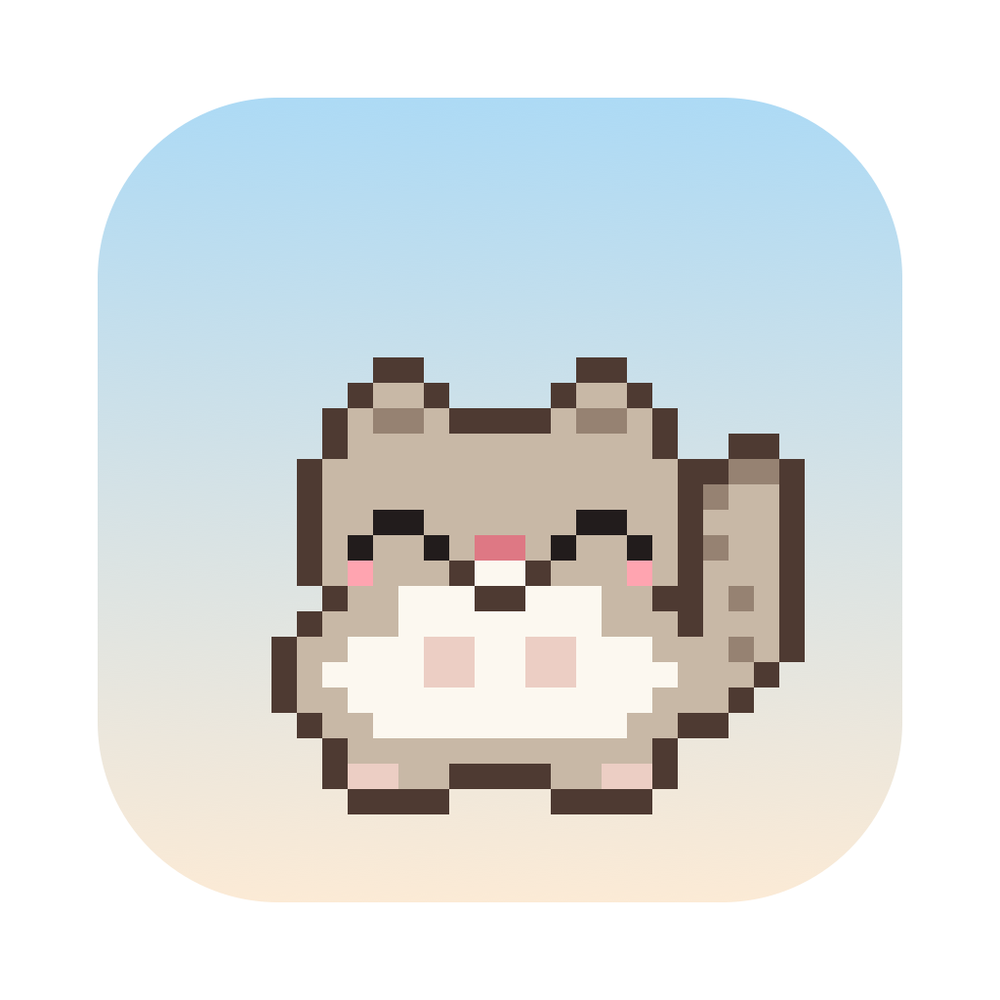

# 하늘다람쥐 🐿️

바탕화면 위를 돌아다니는 macOS 픽셀 하늘다람쥐 펫. Claude Code와 함께 만들었어요.



## 할 수 있는 것

**기본**
- 화면 가장자리를 타고 오르고, 바닥과 창 위를 걸어 다니고, 공중에서는 막을 펴고 활공해요
- 마우스로 잡아서 던질 수 있고, 클릭하면 반응하고, 마우스로 쓰다듬으면 좋아해요
- 가만히 두면 눈을 감고 졸아요
- 위젯·스티커 메모 위에도 올라가요 (바탕화면 모드)
- Spotify / 음악 앱에서 노래가 나오면 가사를 말풍선에 띄우며 따라 불러요 (가사: [LRCLIB](https://lrclib.net))

**도토리와 컨디션**
- 메뉴바에서 도토리를 주면 쫓아가서 냠냠 먹어요
- 시간이 지나면 배가 고파지고, 배고프면 시무룩해져요. 기분이 좋으면 높이 뛰어올라 활강해요
- 배부를 때 받은 도토리는 땅에 묻어뒀다가, 배고파지면 파내서 먹어요
- 메뉴바에서 배고픔·기분·묻어둔 도토리 수를 볼 수 있어요

**하루와 주변**
- 밤(23시~6시)엔 집에 들어가서 자요
- 그날 아침 처음 켜면 기지개를 켜며 인사해요
- 휴지통에 뭘 버리면 Dock 쪽으로 달려가 뒤적거려요 (Finder 제어 권한을 한 번 물어봐요)
- 배터리가 부족하면 기운이 없고, 충전기를 꽂으면 좋아해요
- 비나 눈이 오면 우산을 써요 (날씨: [wttr.in](https://wttr.in), 메뉴에서 끌 수 있어요)

**Claude Code 연동**
- Claude가 생각하거나 작업하면 턱을 괴고 같이 고민해요 ("읽는 중", "고치는 중"…)
- 1분 넘게 걸리면 도토리를 까먹으며 기다려요
- 명령이 실패하면 털이 쭈뼛 서고, 테스트가 통과하면 공중제비를 돌아요
- 허락을 기다릴 땐 마우스 쪽으로 다가와 손을 흔들고, 끝나면 "다 했다!"

**성격과 장식**
- 다람쥐마다 이름과 성격이 있고, 성격에 맞는 머리 장식을 해요. 메뉴에서 성격을 바꿀 수 있어요
  - 🧢 장난꾸러기: 마우스를 조금만 흔들어도 달려들고, 술래잡기를 좋아해요
  - 🌰 먹보: 도토리를 보면 전속력으로 달려가고, 배불러도 먹어요
  - 💤 잠꾸러기: 자주 졸고, 일찍 자고 늦게 일어나요 (21시~8시)
  - 🎀 겁쟁이: 마우스를 흔들면 도망가고, 쓰다듬으면 부끄러워해요
  - 🌼 노래쟁이: 노래가 나오면 가사를 맡아 불러요
- 다음에 켜도 같은 다람쥐들이 돌아와요

**다람쥐 집**
- 집을 여러 채 지을 수 있어요 (메뉴 → 다람쥐 집 → 집 한 채 더 짓기, 또는 맵 꾸미기 팔레트의 **집**)
- 집마다 주인을 정할 수 있어요. 주인이 있는 집엔 이름표가 붙고, 그 다람쥐만 들어가요. 주인 없는 집은 집 없는 다람쥐들이 같이 써요
- 집은 끌어서 옮기고, 발판·상자·구름 위에도 올릴 수 있어요. 다람쥐는 길을 찾아 올라가서 들어가요
- 밤엔 들어가서 자고(창문에 불이 켜지고 Zzz가 나와요), 낮에도 가끔 들러요. 누르면 똑똑 노크해요
- 집을 우클릭하면 주인, 모양(나무 오두막, 버섯집, 도토리집, 둥지), 지붕 색, 장식을 고르거나 허물 수 있어요

**맵 꾸미기** (메뉴 → 맵 꾸미기, ⌘E)
- 그림 팔레트에서 오브젝트를 고르고 바탕화면을 클릭하면 놓여요. 끌어서 옮기고, 우클릭이나 지우개로 지워요
- **격자에 맞추기**를 켜면 16pt 칸에 딱딱 맞춰 놓여요
- 상자 위에 상자, 발판 위에 사다리, 사다리 위에 또 사다리… 얼마든지 쌓아서 스카이 타워를 만들 수 있어요
- 놓거나 옮길 때 다람쥐가 오가는 길이 잔상으로 보여요 (실제 움직임과 같은 계산)
  - 초록: 여기까지 올 수 있어요 (점프, 사다리)
  - 파랑: 여기서 내려가는 길
  - 보라 점선: 포털
  - 빨간 점선 ✕: 너무 높거나 멀어서 못 와요
- 놓기 전에 쓰임새도 보여요: 트램펄린·점프 발판·대포·풍선은 날아가는 길과 최고 높이(칸 수), 쳇바퀴·사료통 등은 다람쥐 모션과 대사
- 다람쥐는 발판을 건너건너 길을 찾아가요. 길이 없으면 "저기는 못 가겠어…"
- 오브젝트
  - 발판 / 긴 발판 / 구름: 공중 어디에나 띄우는 발판
  - 상자: 쌓을 수 있는 발판
  - 사다리: 타고 올라가요 (점프로 못 닿는 높이도)
  - 포털: 두 개를 놓으면 한쪽으로 들어가 다른 쪽으로 나와요
  - 사료통: 2분마다 도토리가 쌓이고(최대 7개), 배고프면 와서 먹어요
  - 물그릇: 물을 마시면 기분이 좋아져요
  - 트램펄린: 높이 튀어 올라요
  - 대포: 펑! 하고 멀리 날아가요
  - 쳇바퀴: 올라타서 달려요
  - 도토리 나무: 가끔 도토리가 하나씩 떨어져요
  - 미끄럼틀: 올라가서 슈웅~ 타고 내려와요
  - 공: 다람쥐가 뻥 차고, 지나가다 건드리면 굴러가요
  - 모닥불: 와서 불을 쬐면 기분이 좋아져요
  - 스피커: 노래가 나오면 앞에 와서 춤을 춰요
  - 거울: 와서 자기 모습을 구경해요
  - 점프 발판: 공중에 띄우는 발판. 올라가면 높이 튀어 올라요
  - 바위: 올라설 수 있는 낮은 발판
  - 풍선: 붙잡고 두둥실 떠올랐다가 활강해요
  - 북: 올라가서 둥둥둥
  - 연못: 첨벙첨벙 물놀이
  - 시계탑: 지금 몇 시인지 알려줘요
  - 풍향계: 오늘 날씨를 알려줘요
  - 보물상자: 열어 보면 가끔 도토리가 나와요
  - 망원경: 멀리 구경해요 (밤엔 별 구경)
  - 우체통: 편지가 왔나 확인해요
  - 깃발: 탑 꼭대기에 꽂아 두면 올라와서 "정상 정복!"
  - 화분, 가로등(밤에 켜져요), 버섯, 덤불, 울타리, 눈사람, 선인장, 꽃밭: 장식
- **맵 초기화**: 놓은 오브젝트를 한 번에 전부 치워요 (팔레트 아래 버튼이나 메뉴, 확인 창이 떠요)
- **묻은 도토리 치우기**: 바닥에 묻어 둔 도토리 더미를 전부 없애요

**여러 마리일 때**
- 가끔 술래잡기를 하고, 도토리 하나를 두고 "내꺼야!" 하며 다퉈요
- 노래가 나오면 한 마리가 가사를 부르고 나머지는 화음을 넣어요

## 설치

```sh
./build.sh
```

`~/Applications/하늘다람쥐.app` 이 만들어져요. 메뉴바 아이콘에서 켜고 끌 수 있어요.

## Claude Code 연동 (선택)

1. `hook.sh` 를 `~/.squirrel/hook.sh` 로 복사
2. `~/.claude/settings.json` 의 `hooks` 에 `UserPromptSubmit`, `PreToolUse`, `PostToolUse`, `PostToolUseFailure`, `PermissionRequest`, `Stop`, `Notification`, `SessionEnd` 이벤트마다 아래 명령을 추가

```json
{ "type": "command", "command": "/bin/sh \"$HOME/.squirrel/hook.sh\"", "timeout": 5, "async": true }
```

훅은 이벤트 이름, 도구 이름, 테스트 명령이었는지 여부만 `~/.squirrel/claude-state` 에 기록해요. 명령 내용은 저장하지 않아요.
